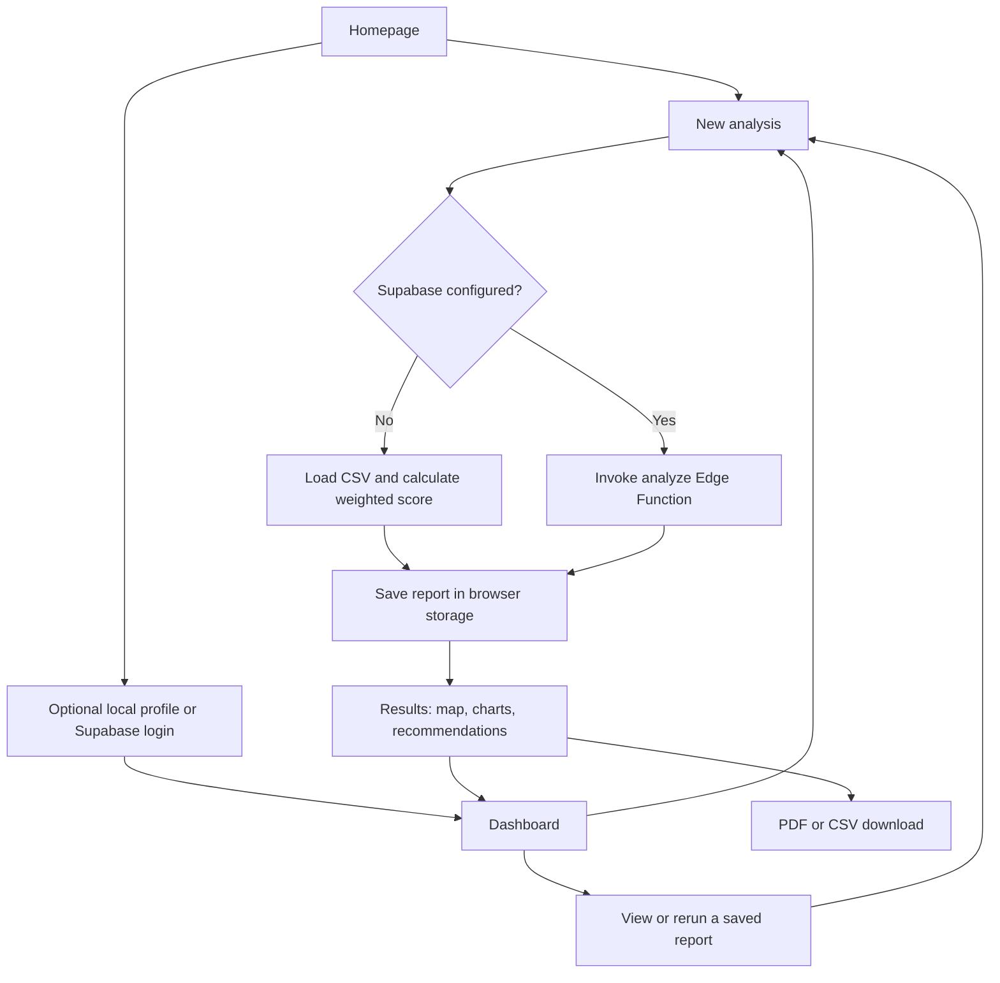
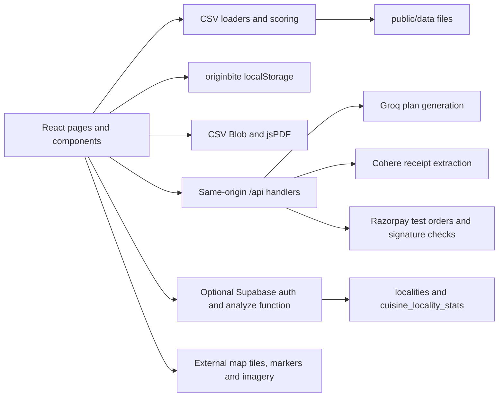

# OriginEats — Product Requirements and Agent Handoff

**Current application name:** OriginBite  
**Document version:** 1.0 · 13 October 2026  
**Scope:** The entire local project, including public pages, workspace pages, all nine Business Studio tabs, data processing, APIs, environment setup, user journeys, and implementation gaps.

This document describes both the intended product and the code currently present in this repository. It is designed to be shared with another developer or coding agent. Read the implementation-status notes before treating a visible feature or marketing claim as a completed backend capability.

The repository originated from [rajhodedara/OriginEats](https://github.com/rajhodedara/OriginEats). The visual and feature reference supplied by the owner is [the original OriginEats website](https://origin-eats-5o4d.vercel.app/). This adaptation uses the name **OriginBite**, forest-green styling, and different typography. The requested document filename remains `OriginEats.md`.

## Contents

1. [Product purpose and users](#1-product-purpose-and-users)
2. [Scope and implementation status](#2-scope-and-implementation-status)
3. [Information architecture](#3-information-architecture)
4. [Complete user journeys](#4-complete-user-journeys)
5. [Public homepage](#5-public-homepage)
6. [Identity and shared workspace](#6-identity-and-shared-workspace)
7. [Dashboard](#7-dashboard)
8. [New location analysis](#8-new-location-analysis)
9. [Analysis results](#9-analysis-results)
10. [Business Studio and all nine tabs](#10-business-studio-and-all-nine-tabs)
11. [Deal Box](#11-deal-box)
12. [Plans and test checkout](#12-plans-and-test-checkout)
13. [Help and recovery](#13-help-and-recovery)
14. [Architecture and file ownership](#14-architecture-and-file-ownership)
15. [Data models and persistence](#15-data-models-and-persistence)
16. [API contracts and integrations](#16-api-contracts-and-integrations)
17. [Environment and local setup](#17-environment-and-local-setup)
18. [Design and quality requirements](#18-design-and-quality-requirements)
19. [Acceptance criteria and verification](#19-acceptance-criteria-and-verification)
20. [Known gaps and next-agent priorities](#20-known-gaps-and-next-agent-priorities)
21. [Product success measures and handoff brief](#21-product-success-measures-and-handoff-brief)

## 1. Product purpose and users

OriginBite is a restaurant research and planning workspace focused on Mumbai. It helps a prospective restaurant owner move from an idea to a location assessment, competitor review, financial scenario, and draft business plan.

The main problem is fragmented early-stage research: founders must compare neighbourhoods, restaurant competition, cuisines, investment constraints, menu ideas, and launch strategies across separate tools. OriginBite brings these activities into one browser workspace and retains the resulting research for later review.

It supports decisions and questions; it does not establish commercial viability. Ratings and reviews are demand proxies, a location score is a weighted heuristic, and revenue projections depend on assumptions. There is no trained restaurant-success prediction model in this repository.

| User | Problem | Value provided |
| --- | --- | --- |
| First-time founder | Does not know where to start or which area to explore | Guided analysis form, contextual advice, maps, and a structured plan |
| Existing restaurateur | Wants to explore a new location or cuisine | Repeatable location analyses and saved report history |
| Cafe/cloud-kitchen operator | Needs to fit a concept to a limited budget | Budget guidance, suggested menu, financial assumptions, and stress tests |
| Collaborator or advisor | Needs a shareable explanation of the idea | CSV/PDF analysis exports and business-plan PDF/share URL |
| Developer or evaluator | Needs to exercise the whole flow without purchasing services | Local datasets, template planning, demo identity, and dummy checkout |

The restaurant datasets are Mumbai-focused. Business Studio accepts a free-text city, but this does not provide verified coverage of another city. In particular, the local Rivals lookup still searches the bundled Mumbai restaurants.

## 2. Scope and implementation status

The owner requires a similar feature set and layout to the reference, with a slightly different name, colour palette, and font. Payments must remain test-only even in a production deployment.

Status vocabulary used here:

- **Implemented local:** works from bundled data or browser storage without account credentials.
- **Integration present:** code exists, but the owner's credentials and external resources are required; successful live integration has not been established by this document.
- **Illustrative:** deliberately uses sample values, templates, or assumptions.
- **Gap:** visible claim or desired capability is not fully implemented.

| Capability | Current status | Important boundary |
| --- | --- | --- |
| Homepage, navigation, FAQ, story carousel | Implemented local | Homepage quick scorer uses a preset matrix |
| Name-only workspace entry | Implemented local | A local profile is not authentication |
| Email/password signup and login | Integration present: Supabase | Requires a configured project and auth settings |
| Locality/cuisine selection and scoring | Implemented local; optional Supabase path | Static dataset, not live market research |
| Map, restaurant filters, competitor distances | Implemented local with external map assets | Data is bundled; tiles require network access |
| Saved analysis history, sorting, rerun | Implemented local | Up to 100 reports in this browser origin |
| Analysis CSV/PDF exports | Implemented local | Summary export, not a full interactive map capture |
| Revenue and monsoon scenarios | Illustrative calculation | Not a forecast model |
| Dashboard market trends and competitor prices | Illustrative | Fixed sample values remain in parts of the UI |
| Business Studio base plan | Local template or Groq integration | Templates work without Groq; AI output requires review |
| Rivals, What If, Roast Me | Local fallback or Groq integration | Supplementary results are transient tab state |
| Receipt text entry and sample coupon | Implemented local | Coupon is not redeemable |
| Receipt image extraction | Integration present: Cohere | Image is sent only when extraction is requested |
| Dummy UPI/card checkout | Implemented local | No payment details and no transaction |
| Razorpay hosted test checkout | Integration present | Requires matching test key ID and server secret |
| Cloud report sync, true paid entitlements, live alerts, support SLA | Gap | Do not infer these from subscription copy |

Out of scope today: food ordering/delivery fulfilment, table reservations, inventory/POS, real billing, real coupon redemption, team permissions, a restaurant-owner admin panel, and a complete production multi-tenant backend.

## 3. Information architecture

Routes are registered in `src/Routes.jsx`.

| Route | Page | Main responsibility |
| --- | --- | --- |
| `/` | Homepage | Explain product and lead users into analysis/workspace |
| `/homepage` | Alias | Redirect to `/` |
| `/login` | Authentication/local entry | Name-only local profile or Supabase signup/sign-in |
| `/user-dashboard` | Dashboard | Saved research, summary statistics, sample trends |
| `/new-analysis` | New analysis | Collect locality, cuisine, budget, metro preference, timeline |
| `/analysis-results` | Results | Score, map, charts, recommendations, exports |
| `/business-plan` | Business Studio | Create and explore a restaurant plan in nine tabs |
| `/coupons` | Deal Box | Receipt preview/text extraction and sample reward |
| `/subscription-tiers` | Plans | Compare Free/Pro and choose a test billing cycle |
| `/payment-processing` | Test checkout | Dummy or Razorpay Test Mode flow |
| `/help` | Help & about | Product workflow, storage/privacy, service setup, payment terms |
| `/help#privacy` | Help anchor | Local data and external processing explanation |
| `/help#terms` | Help anchor | Planning limitations and test-payment terms |
| Any other path | Not found | Recovery navigation |

Business Studio tab IDs are `concept`, `menu`, `financials`, `location`, `marketing`, `competitors`, `whatif`, `roast`, and `summary`. They are internal React state, not separate URLs.

The shared sidebar links Dashboard, New Analysis, Analysis Results, Business Studio, Deal Box, and Subscription. It also offers homepage and analysis shortcuts. On small screens it becomes an overlay opened by a menu button.

## 4. Complete user journeys

### 4.1 First visit to saved location research

1. Open the homepage and review the three feature groups or workflow steps.
2. Optionally try the homepage scorer. This produces an illustrative example, not a saved analysis.
3. Choose **Start free analysis**. A login is not currently required by route guards.
4. Select a locality and cuisine; adjust the budget, metro preference, and timeline.
5. Read local contextual guidance as selections change.
6. Submit. The app validates input, runs local scoring or the configured Supabase function, and saves a report.
7. Review results, change map filters/layers, examine cuisine distribution and revenue scenarios.
8. Export PDF/CSV or start another analysis.
9. Open Dashboard to filter/sort saved reports, view a previous result, or rerun with its inputs prefilled.



### 4.2 Concept to business plan

1. Open Business Studio from the sidebar or analysis-page shortcut.
2. Enter investment budget, city, neighbourhood, restaurant vibe, and optional cuisine.
3. Generate the plan. The app calls `/api/ai` for Groq.
4. If Groq is unconfigured, the client uses a local planning template. A configured provider failure is shown as an error instead of silently substituting a template.
5. Review the identity header and Concept, Menu, Financials, Location, Marketing, and Summary tabs.
6. Run Rivals research, a What If scenario, or a Roast Me critique on demand.
7. Download the base-plan PDF or copy a share URL.
8. Return later to reopen the last saved base plan. A valid plan embedded in the URL takes precedence over the locally saved one.

### 4.3 Test subscription upgrade

1. Open Plans and switch monthly/yearly billing if desired.
2. Select Pro; checkout receives the selected cycle through router state.
3. Choose Dummy UPI, Dummy card, or Razorpay Test Mode.
4. Dummy mode can simulate failure, then retry successfully without entering payment information.
5. Razorpay mode creates a server-side test order, opens hosted test checkout, then verifies the signature on the server.
6. A successful flow writes a local Pro demo status and shows a test receipt.
7. Return to Dashboard. Choosing Free on the Plans page resets local plan status; it does not call a subscription-cancellation service.

### 4.4 Receipt to sample coupon

1. Open Deal Box.
2. Upload/drop a supported receipt image, paste receipt text, or load the sample receipt.
3. If using an image, choose Extract to send it through the server to Cohere.
4. Review/edit extracted text.
5. Generate a sample coupon, view its expiry, and copy its code.
6. Revisit Deal Box to see the last locally stored coupon. It has no monetary value or merchant redemption integration.

## 5. Public homepage

**Purpose:** Explain the workspace and give users a low-effort path from curiosity to analysis.

**Source:** `src/pages/homepage/index.jsx`; styling in `src/styles/originbite.css`.

| Section | What the user sees/does | Problem solved | Internal behaviour |
| --- | --- | --- | --- |
| Header | Brand, Features, How it works, Pricing, Why OriginBite, Sign in, Deal Box | Find important entry points | Router links and section anchors; mobile menu uses component state |
| Hero | Main positioning, analysis CTA, workflow CTA | Understand the product quickly | Analysis CTA opens `/new-analysis`; workflow CTA scrolls to the steps |
| Feature cards | Local insights, revenue planning, competitor intelligence | Understand the three core jobs | Static descriptive content |
| Three-step workflow | Select location → explore analysis → plan next move | Reduce uncertainty about how to start | Static explanation with actionable nearby links |
| Location potential scorer | Pick one of six areas and six cuisines | Try the interaction before completing a full form | Looks up a score from a 6×6 array; result resets when either selection changes |
| Story carousel | Three product-use stories with arrows/dots | Illustrate practical use cases | Local active-slide state; these are product stories rather than verified testimonials |
| FAQ | Six expandable questions | Explain data, coverage, comparisons, Studio, and test payments | One expanded item at a time |
| Closing CTA/footer | Start analysis, plans, workspace, help/privacy/terms links | Provide a next step after reading | Normal navigation |

Quick-scorer areas: Bandra West, Juhu, Colaba, Dadar, Powai, Lower Parel. Cuisines: North Indian, Fast Food, Cafe, Maharashtrian, South Indian, Chinese. These are demonstration options; they are not the dynamic locality/category list used by full analysis. The scorer does not save a report or automatically prefill the analysis form.

## 6. Identity and shared workspace

### Local profile

With no usable Supabase client configuration, `/login` asks for a name and creates `originbite:profile`. The name personalises greetings and the account menu. No password, email identity verification, or server account is created.

This solves the blank-credentials onboarding problem and allows a complete demonstration. It does not isolate one user's reports from another user on the same browser origin.

### Supabase identity

When Supabase URL and public anon key initialise a client, the same page offers email/password sign-in or signup. Signup includes `first_name` metadata. If signup returns no session because confirmation is required, the UI asks the user to check their email.

The account menu obtains user information with `supabase.auth.getUser()`. Sign-out calls Supabase when configured. **Profile settings currently points back to `/login`; it is not a dedicated profile editor.** There is no password-reset screen, OAuth flow, role management, or guarded private-route layer in the active route configuration.

### Shared navigation and session behaviour

The account dropdown provides profile, subscription, help, and sign-out/leave-demo actions; it closes on Escape or outside interaction. Leaving a demo profile removes the local profile, but keeps reports, business plan, coupon, and subscription data.

`Workspace.jsx` supplies a common shell for Help, Deal Box, and Test Checkout. Dashboard/analysis/plans compose similar shared components themselves. Business Studio has its own dark layout and a workspace return link.

## 7. Dashboard

**Sources:** `src/pages/user-dashboard/index.jsx` and its `components/` directory.

| Feature | Behaviour and benefit | Internal source |
| --- | --- | --- |
| Welcome panel | Personalised greeting/date; provides a workspace starting point | Local profile or Supabase user metadata; client clock |
| Start New Analysis | Opens the form | Router navigation |
| View Market Trends | Scrolls to the trends section | `/user-dashboard#market-trends` and `ScrollToTop` hash handling |
| Analysis history | Shows date, location, cuisine, planning score, actions | `getReports()` reads browser storage |
| Location filter | Narrows saved reports to a locality | Unique locations derived from saved report inputs |
| Sorting | Newest first, highest score, or location A–Z | Client-side sorting |
| View | Reopens a selected saved report | Passes that report as router state |
| Rerun | Opens an editable form prefilled from a previous report | Passes `analysisInput` as router state |
| Export CSV | Downloads the selected report summary | `exportCSV(report)` |
| Empty state | Invites the first analysis instead of displaying fabricated history | Rendered when the filtered result set is empty |
| Statistics | Total report count, average planning score, best-scoring location | Computed from locally saved reports |
| Market trends | Demand/cuisine charts and market KPI examples | Static sample arrays, not a live analytics feed |
| Pro promotion | Leads to plan comparison/test checkout | Local plan state and navigation |

History is loaded when the component mounts. There is no multi-user database history, report deletion UI, or side-by-side comparison screen. Comparison means running multiple analyses and revisiting/exporting them. The local report collection retains the newest 100 records.

Some inherited dashboard copy still mentions current market growth and support benefits. Those phrases must not be interpreted as evidence of live data or an operating support service.

## 8. New location analysis

**Sources:** `src/pages/new-analysis/`, `src/lib/localData.js`, `src/lib/scoring.js`.

### Inputs and validation

| Input | Behaviour | Purpose |
| --- | --- | --- |
| Location | Required dropdown; localities from CSV or Supabase | Sets the neighbourhood being evaluated |
| Cuisine | Required dropdown; unique restaurant categories or Supabase categories | Identifies relevant cuisine competition |
| Budget | Default ₹25 lakh; slider ₹5 lakh–₹1 crore in ₹1 lakh steps | Influences feasibility score and revenue scenario |
| Near Metro Station | Boolean preference | Adds a scoring adjustment; not an actual metro-distance lookup |
| Opening timeline | Optional 3, 6, 9, or 12+ months | Represents readiness/launch horizon |

The UI requires location, cuisine, and a budget of at least ₹5 lakh. The local scoring function also rejects non-finite budgets. A submit failure appears in the form. The loading state prevents repeated submission while work is in progress.

### Contextual guidance

With local mode and both selections available, the page calculates a preview as the form changes. It shows demand, competition, opportunity, ratings/review activity, and conditional suggestions. With Supabase configured, this live local preview is not run; submission is the remote analysis path.

Budget advice groups investments into compact (<₹10 lakh), small (<₹30 lakh), mid-size (<₹60 lakh), and premium setups. Suggested setup/equipment/working-capital allocations are templates, not vendor quotations.

### Local processing sequence

1. Fetch `/data/area_summary.csv` and `/data/restaurants.csv` using a cached promise.
2. Parse with Papa Parse; clear the cache on failure so a later request can retry.
3. Match `locality` exactly to the selected location.
4. Filter that locality's restaurants by `primary_category` for cuisine statistics.
5. Count matches, average positive ratings, and total their review counts.
6. Calculate the weighted score below.
7. Average available locality coordinates for the map centre; use central Mumbai if none are available.
8. Return the result with `mode: "local"` and source descriptions.
9. Save report and navigate to results.

### Scoring specification

Define `N(value, maximum) = clamp(round(value / maximum × 100), 0, 100)`.

| Metric | Calculation |
| --- | --- |
| Demand D | `N(locality.total_demand_score, 1000)` |
| Opportunity O | `N(locality.opportunity_score, 100)` |
| Competition C | `100 - N(matchingCuisineRestaurantCount, 50)`; higher means fewer matching competitors |
| Rating R | `N(locality.avg_rating × 20 + log10(max(1, locality.total_reviews)) × 20, 120)` |
| Budget fit B | Cuisine-group and budget thresholds below |
| Metro adjustment M | `+5` when selected, otherwise `0` |
| Timeline adjustment T | `-6` for legacy `Within 1 month`; `-2` for `1-3 months` or local `3-months`; otherwise `0` |

`planningScore = clamp(round(0.30D + 0.25C + 0.20O + 0.15R + 0.10B + M + T), 5, 95)`

Risk labels: Low at 75+, Medium at 50–74, High below 50. These are heuristic categories, not validated failure probabilities.

Budget fit groups:

- Low-cost: Fast Food, Burger, Sandwich, Cafe, Juice, Breakfast / Brunch, Dessert, Bakery, Pizza.
- Mid-cost: Indian, Chinese, Lebanese, Mexican, Mediterranean, Middle Eastern, Thai, Seafood.
- High-cost: Japanese, Korean, Italian.

Below ₹10 lakh, low-cost cuisines score 85 and other cuisines 45. From ₹10 lakh to below ₹35 lakh, low/mid score 80 and others 60. At ₹35 lakh or more, mid/high score 85 and others 70. Category labels are matched literally.

The result field is named `successRate` for compatibility with existing components. Some components still display it as a percentage or “Success Probability”; its correct interpretation is a planning score.

### Optional remote processing

`runAnalysis()` uses `supabase.functions.invoke('analyze')` when a Supabase client exists. It sends locality, cuisine, budget converted to lakhs, metro preference, and timeline. The Edge Function reads locality and cuisine aggregates from two database tables and applies a similar heuristic.

Known parity issues: the remote function recognises the legacy timeline strings but not the current `3-months` UI value; it does not return coordinates; and its validation is less strict than the local function. Remote results can therefore differ and may centre maps on the Mumbai fallback. A configured but failing Supabase backend surfaces an error; it does not automatically switch to CSV mode.

## 9. Analysis results

**Source:** `src/pages/analysis-results/`.

The page uses a report supplied through router state, otherwise the latest saved report. If neither exists, it redirects to New Analysis. Router state retains the selected report on ordinary same-entry refreshes; a fresh direct visit without that state selects the latest local report, not a report identified by URL.

### 9.1 Score and factors

Shows the overall score, risk label, and five explanations: demand, cuisine competition, opportunity, review/rating engagement, and budget fit. This helps the user understand what influenced the result rather than receiving an unexplained number.

### 9.2 Area Intelligence map

The map uses React Leaflet/Leaflet and `restaurants.csv`. The analysis locality and the map's area grouping are different fields: analysis uses `locality`; map filters use `area_name`.

| Control/output | Internal behaviour | User benefit |
| --- | --- | --- |
| Demand Heatmap | Weighted points `[lat, lng, min(1, demand_score / 60)]` | See relative clusters of recorded restaurant activity |
| Competitors | Restaurant marker/popup view | Inspect nearby restaurants and their dataset attributes |
| Opportunity | Markers for the top 10 filtered restaurants by demand, alongside ranked area shortcuts | Explore prominent outlets and areas with high demand per recorded outlet |
| Area filter | Case/whitespace-normalised `area_name` match | Focus map and related results on a broader area |
| Cuisine filter | Exact category match | Explore one type of outlet |
| Map centre | Selected area's mean restaurant coordinates or report centre | Move between areas without manual panning |
| Restaurant list | Top 10 filtered restaurants by `demand_score` | Identify prominent outlets within the selection |
| Nearest competitors | Haversine distance from report centre; nearest 25 candidates | Understand geographical proximity, not travel time |
| Dataset count | Number of loaded restaurant rows | Show the dataset's scope |

Area summaries are recomputed from the restaurant file. Map opportunity is `total_demand_score / (restaurant_count + 1)`. The top-eight opportunity areas and highest-demand area exclude `Other`. This map metric is distinct from the precomputed `opportunity_score` in the analysis locality CSV.

Selecting an opportunity-area shortcut changes the area filter, resets cuisine to `ALL`, and preserves the active map layer. The separate `src/components/maps/OpportunityLayer.jsx` circle-marker implementation is not the opportunity rendering used by this active results component.

Area and cuisine filters initially default to `ALL`; they do not automatically become the original form's selections. Changing map filters does not recalculate the saved location score. External tile and marker services are used, so this is not a completely offline map.

### 9.3 Cuisine chart

The chart counts restaurants in each cuisine among the current area/cuisine-filtered rows. It displays the five largest categories and combines the remainder as Others, using rounded percentages. Despite “demand” wording in the interface, these percentages represent the distribution of listed outlets, not customer orders or market share.

### 9.4 Competitor pricing chart

Compares “your price” and “competitor average” across starters, mains, breads, desserts, and beverages. Its values are currently fixed examples in the results page, not extracted menu prices. It serves as a comparison interface demonstration. Connecting trustworthy pricing data is unfinished.

### 9.5 Revenue and monsoon simulation

For budget `B` in rupees and planning score `S`, the local scenario uses:

```text
base = B × 0.16 × (0.7 + S / 100)
month[i] = round(base × (0.7 + i × 0.045)), i = 0..11
monsoonMonth[i] = round(month[i] × 0.8) for June–September
```

The chart labels January–December rather than beginning at the user's selected launch date. The Monsoon Impact button switches between base and adjusted series; summary figures update from the displayed values. This is a transparent investment-sensitive scenario, not weather data or AI forecasting. Business Studio uses a separate financial model described below.

### 9.6 Recommendations

Conditional rules turn metrics into recommendation cards covering launch marketing, menu differentiation, pricing, customer experience, budget fit, and accessibility. Expanded cards contain action steps. For example, high demand triggers stronger launch advice; low competition-score or at least eight matching outlets triggers differentiation advice.

The cards' numerical revenue impact, implementation cost, and ROI are example constants. They are not measured outcomes. The recommendations on this page do not call Groq.

### 9.7 Report exports

- **CSV:** one summary record with location, cuisine, investment, score, risk, timestamp, and mode. It quotes cells, escapes quotes, neutralises leading spreadsheet-formula characters, and includes a UTF-8 BOM.
- **PDF:** jsPDF-generated text report containing inputs, score/risk, date, factors, and the base 12-month revenue scenario, with page breaks. It does not include the full interactive map, current map-filter state, or every recommendation.
- **New Analysis / Upgrade:** route to the next workflow.

Files download through the browser. They are not stored on a report server or sent by email.

## 10. Business Studio and all nine tabs

**Main source:** `src/pages/business-plan/index.jsx`.  
**Supporting logic:** `src/lib/ai.js`, `src/lib/planTemplates.js`, `api/ai.js`.

### 10.1 Input, generation, and shared plan header

Inputs: budget in rupees, city, area/locality, restaurant vibe, optional cuisine. Defaults are ₹8 lakh, Mumbai, Andheri East, fast casual, and no explicit cuisine. Local generation requires at least ₹50,000 and nonempty city/area.

Vibes: fast casual, fine dining, cloud kitchen, café, street food, health & wellness, and bar & grill.

Generation progresses through input → loading → plan or error. Loading-step messages are timed presentation states, not progress events from the provider. The generated header includes a restaurant name, tagline, theme/personality, palette, and location context. Users can create a new plan, copy a share link, or download the base plan.

The Groq prompt requests structured JSON for identity, audience, menu, location reasoning, financial assumptions, launch content, and a summary. The client strips markdown code fences and calls `JSON.parse`; a complete schema validator has not yet been implemented.

If the server explicitly returns `code: "not_configured"`, `requestAI()` runs the supplied local fallback. Network errors, provider errors, and malformed AI JSON are shown rather than disguised as successful AI generation. A plain static file server without `/api/ai` is not sufficient for this fallback path.

### 10.2 Concept tab

**Problem solved:** The founder needs a coherent concept and target customer, not only a list of dishes.

**Displays:** target audience and why the concept might fit. Shared header identity fields provide name, tagline, cuisine/theme, personality, and palette.

**Internals:** reads `targetAudience` and `conceptWhy` from the base plan. Local templates describe residents, office workers, and visitors around the supplied area, and recommend validating demand with interviews/tastings. Groq generates text when configured. No customer research is conducted automatically.

### 10.3 Menu tab

**Problem solved:** Turn a cuisine/vibe idea into a starting menu and pricing discussion.

**Displays:** categorised dish cards containing name, description, image, and price; followed by pricing rationale.

**Internals:** groups `plan.menu` by category. Local templates produce 10 items: three snacks, four mains, two beverages, one dessert. Dish sets vary for Italian, Chinese/Asian, cafe, or the default Indian-style selection. Vibe changes suggested prices. Static keyword-to-image mappings use external food images with loading/error handling; images are illustrative and are not generated by AI.

There is no implemented recipe-cost calculator, ingredient inventory, menu ordering, or menu-item editing interface. Prices are assumptions until the owner supplies recipe and operating costs.

### 10.4 Financials tab

**Problem solved:** Make the relationship between budget, order volume, revenue, expenses, and payback visible.

**Displays:** budget, setup cost, average order, daily orders, monthly revenue/opex, margin, break-even months, monthly bars, and a 12-month chart.

Local base-plan assumptions:

```text
average order = INR 700 for fine dining, INR 300 for cafe, otherwise INR 250
daily orders = clamp(round(budget / 50,000), 12, 160)
monthly revenue = average order × daily orders × 30
monthly operating expenses = round(monthly revenue × 0.73)
setup cost = round(budget × 0.70)
break-even months = ceil(budget / max(1, monthly revenue - monthly expenses))
```

Display calculations: margin is `(revenue - opex) / revenue × 100`; the snapshot profit bar clamps negative profit to zero. The 12-month display grows revenue linearly by 6% of baseline per month and expenses by 1.5% of baseline per month. These are assumptions, not compounded growth or a full cash-flow model. The “break-even” estimate is a simple investment-payback approximation. Taxes, financing, depreciation, working-capital timing, and granular rent/staff costs are not modelled.

### 10.5 Location tab

**Problem solved:** Translate a broad neighbourhood preference into premises-selection questions.

**Displays:** recommended micro-location and explanation.

**Internals:** local mode repeats the supplied area/city and suggests checking customer access, permitted use, ventilation, rent, deliveries, and footfall. Groq may propose a more specific location. Neither mode checks property availability, lease prices, permits, or actual pedestrian counts. This tab is text-based rather than the Leaflet analysis map.

### 10.6 Marketing tab

**Problem solved:** Give the founder a practical first launch campaign and draft content.

**Displays:** launch strategy, opening offer, three Instagram post concepts/captions, and a toggle between captions and Instagram-style previews.

**Internals:** local templates describe a tasting, feedback, soft launch, listings, and a suggested offer. Preview images reuse menu imagery. Likes, timestamps, and social controls are decorative samples. No Instagram account is connected and nothing is posted or scheduled. The opening offer is planning copy, separate from Deal Box coupons.

### 10.7 Rivals tab (`competitors`)

**Problem solved:** Identify competitors and questions for differentiation.

**Displays:** competitor cards, type, price/revenue text, threat level, strengths, weaknesses, suggested advantage, market gap, and winning strategy.

**Internals:** entering the Rivals tab mounts the component and automatically starts a Groq request using the plan and form. Without a Groq key, `localCompetitors()` case-insensitively matches the supplied area against restaurant `locality` or `area_name`, sorts matches by review count, and returns up to three. Returning to the tab can start another request because the component is remounted.

Local mode explicitly reports competitor revenue and pricing as unavailable and does not invent operating weaknesses. Empty matches produce explanatory guidance. Groq-mode competitor assertions are generated text without a connected live search/retrieval source, so names, prices, revenue estimates, and weaknesses need independent verification.

### 10.8 What If tab (`whatif`)

**Problem solved:** Explore how a concept might respond to cost shocks or changing demand.

Presets: rent doubles, new competitor nearby, goes viral, supplier prices rise, head chef leaves, orders decline 40%, and custom question.

Outputs: headline, severity, impact explanation, immediate actions, short-term actions, opportunity, and a survival-chance indicator.

Local mode applies these revenue/expense multipliers to the base plan:

| Scenario | Revenue multiplier | Operating-expense multiplier |
| --- | ---: | ---: |
| Rent doubles | 1.00 | 1.20 |
| New competitor | 0.85 | 1.00 |
| Viral demand | 1.40 | 1.18 |
| Supplier increase | 1.00 | 1.12 |
| Key staff leaves | 0.80 | 1.05 |
| Orders decline | 0.60 | 0.90 |
| Custom / generic stress test | 0.85 | 1.10 |

The rent/supplier multipliers affect total opex; there is no itemised cost ledger. Local custom questions are displayed but not semantically interpreted. The survival indicator is a clamped ratio-derived heuristic, not a calibrated probability. Groq mode asks the provider to generate a scenario-specific response.

### 10.9 Roast Me tab (`roast`)

**Problem solved:** Challenge optimistic assumptions before the founder commits resources.

**Displays:** candid overall verdict, score and label, issues/critiques/fixes, biggest risk, hidden strength, final advice.

**Internals:** on-demand Groq response or a local checklist. The local version uses a fixed score of 60 and challenges assumed order volume, working capital, menu discipline, and location research. It is a structured review template, not an independent audit or an empirical viability rating.

### 10.10 AI Summary tab (`summary`)

**Problem solved:** Condense the base plan into a shareable narrative.

**Displays:** `plan.aiSummary`, under a planning-summary heading. Local mode explicitly describes the template and its illustrative financial assumptions. The tab name is inherited; opening it does not issue a new AI request or combine the transient Rivals/What If/Roast results.

### 10.11 Save, share, export, reset

- A successful base plan overwrites `originbite:business-plan` with `{ plan, form }`. This is one last-saved plan, not a plan library.
- Rivals, scenario, and roast results are held in their respective component states; switching away can discard them. They are not added to the saved base plan.
- Share serialises `{ plan, form }`, URI-encodes and Base64-encodes it into `?plan=...`, and copies a URL. This is not encrypted, access-controlled, or a server-hosted share record. Anyone with the full URL can read the embedded plan. Localhost links only resolve on a device with the corresponding local server; they are not publicly accessible deployment links.
- A share URL is loaded before the last local plan. Invalid decoding falls back to local/input state, but structurally malformed decoded objects still need stronger validation.
- The Business Plan PDF includes base concept, identity, menu/pricing, financials, location, marketing, and summary. It does not include the three transient on-demand tab results. It uses built-in PDF fonts; currency glyphs and long content need visual QA.
- New-plan reset clears the current view and URL query, but does not erase the last saved plan. Reloading can restore it until another plan is saved or site storage is cleared.

## 11. Deal Box

**Source:** `src/components/coupons.jsx`.

**Problem solved:** Demonstrate a receipt-to-reward interaction and provide a receipt-reading utility when extraction is configured.

Input options: PNG/JPEG/WebP image up to 2 MB, pasted text, or a built-in sample receipt. File selection/drop creates a preview; the user can remove it. Extraction is an explicit action rather than an automatic upload on file selection.

When Extract is selected, a base64 data URL is posted to `/api/ai` with `provider: "cohere"`. The server asks the configured vision model to return visible text only. The user can edit the resulting text. Missing configuration, unreadable receipts, provider errors, and unsupported/oversized files have error paths.

Coupon generation requires at least 10 trimmed characters. It creates a random code beginning `BITE`, the fixed offer “10% off your next visit,” and an expiry seven days ahead. The coupon is saved to `originbite:coupon`, shown as a sample reward, and can be copied. Text content is not used to validate a purchase, compute spend-based rewards, or prevent duplicates. Expiry is displayed, not enforced by a redemption backend.

Receipt text/image is component state rather than a receipt archive. The stored coupon contains code, offer, and expiry, not the uploaded image. There are no merchant integrations, reward balances, fraud detection, or real redemption endpoints.

## 12. Plans and test checkout

**Sources:** `src/pages/subscription-tiers/`, `src/pages/payment-processing/index.jsx`, `api/test-payment.js`.

### Plan comparison

The page contains Free/Pro cards, a monthly/yearly toggle, feature comparison, FAQ, and inherited promotional/trust content. The intended plan positioning contrasts basic exploration with deeper reporting and planning.

Current displayed prices are ₹999/month and ₹9,590/year for Pro. The annual base price saves ₹2,398 against twelve monthly base payments. The checkout adds an illustrative 18% GST rounded to whole rupees:

| Cycle | Base | GST estimate | Test total | Order amount in paise |
| --- | ---: | ---: | ---: | ---: |
| Monthly | ₹999 | ₹180 | ₹1,179 | 117900 |
| Yearly | ₹9,590 | ₹1,726 | ₹11,316 | 1131600 |

These are test amounts, not a tax invoice. There is no actual recurring subscription mandate or renewal scheduler.

The comparison copy includes allowances such as three Free analyses, differing forecast lengths, priority support, and live updates. These are not enforced/connected features in the current local build. Analyses, Studio, and exports remain accessible; local Pro status does not represent a secure paid entitlement. Subscription copy must be reconciled with actual behaviour before presenting service promises.

### Dummy checkout

Dummy UPI/card requires no UPI ID or card details. An optional failure toggle produces a recoverable error. Success creates a `demo_...` reference and saves local Pro status. The user sees explicit no-charge messaging.

### Razorpay test checkout

1. Browser requires `VITE_RAZORPAY_KEY_ID` beginning `rk_test_`; other prefixes are rejected.
2. Browser sends `{ action: "create", cycle }` to the server.
3. Server independently enforces the test prefix and requires `RAZORPAY_KEY_SECRET`.
4. Server derives the amount from an allowlisted cycle rather than accepting a client amount.
5. Server creates a Razorpay order using Basic authentication and a 15-second request timeout.
6. Browser loads the official hosted checkout script and opens it with the returned order ID and amount.
7. On success, the browser posts order ID, payment ID, and signature for verification.
8. Server checks `HMAC-SHA256(orderId + "|" + paymentId, secret)` using timing-safe comparison.
9. Only then does the browser mark local Pro demo status and display success.

Script-load failure, timeout, dismissal, payment failure, missing credentials, live key, and invalid signature have error paths. **Do not remove the test-only checks in a deployment.** The owner explicitly requires no real transactions, including production.

The server does not persist orders, bind them to authenticated users, process webhooks, or maintain subscription entitlements. Signature verification is useful for the test integration but is not a complete production billing system. Never describe locally editable Pro state as authoritative payment proof.

## 13. Help and recovery

Help explains the location-to-plan workflow, browser persistence, external processing, planning limitations, and test-only payments. It gives a direct route back to analysis. It is documentation, not an integrated support desk.

The route-level error boundary provides recovery from render errors. It cannot catch failures during module import; the original blank screen was caused by initialising Supabase with missing values before React rendered. `src/lib/supabase.js` now guards configuration and exports a nullable client so pages can use local behaviour.

The application also restores shared styles and Leaflet CSS through `src/main.jsx`, the real entry point. `src/index.jsx` exists but is not the entry loaded by `index.html`.

## 14. Architecture and file ownership



| Layer / path | Responsibility |
| --- | --- |
| `index.html` → `src/main.jsx` → `App` → `Routes` | Vite browser bootstrap, CSS imports, app/router composition |
| `src/pages/homepage/` | Active landing page |
| `src/components/homepage/` | Older modular homepage components; not the active landing composition |
| `src/components/AuthPage.jsx` | Local profile or Supabase identity form |
| `src/components/ui/` | Sidebar, account menu, breadcrumbs, shared controls |
| `src/components/Workspace.jsx` | Shared page shell |
| `src/pages/new-analysis/` | Form, validation, contextual preview, submission |
| `src/pages/analysis-results/` | Map, charts, recommendations, exports |
| `src/pages/user-dashboard/` | Report history, statistics, sample trends |
| `src/pages/business-plan/index.jsx` | Large Studio module, tabs, prompt composition, PDF, share URL |
| `src/lib/localData.js` | CSV cache, selector sources, local/remote analysis switching |
| `src/lib/scoring.js` | Pure weighted heuristic and analysis revenue formula |
| `src/lib/planTemplates.js` | Local base plan, scenario, rivals, critique fallbacks |
| `src/lib/storage.js` | Browser persistence helpers and report limits |
| `src/lib/exports.js` | Analysis CSV/PDF creation |
| `src/lib/ai.js` | Client AI request and missing-key fallback routing |
| `src/lib/supabase.js` | Guarded optional Supabase client |
| `src/utils/dataLoader.js` | Map restaurant, ward CSV, and GeoJSON loaders |
| `api/ai.js` | Server-side Groq/Cohere proxy |
| `api/test-payment.js` | Server-side test order creation/signature verification |
| `server/dev-api.js` | Mounts the API handlers in Vite dev and preview |
| `vite.config.js` | Active default config, React plugin, aliases, server env loading |
| `vite.config.mjs` | Additional legacy config; not the normal default config |
| `vercel.json` | SPA rewrites while preserving API/assets/data requests |
| `supabase/functions/analyze/index.ts` | Optional Deno Edge Function |
| `tests/core.test.mjs` | Node tests for scoring, projections, payment guard/signatures, missing credentials |
| `src/styles/originbite.css`, Tailwind/styles files | Brand tokens, landing/workspace styles and responsiveness |

Primary stack: React 18, React Router 6, Vite 7, Tailwind CSS 3, Lucide icons, Papa Parse, Recharts, Leaflet/React Leaflet, Supabase JS, and jsPDF. Most state is component state plus localStorage; Redux being installed does not mean it manages these workflows.

The API handlers use Node APIs, including `node:crypto`. The optional Supabase function uses Deno. Do not move Node secret-handling modules into client imports.

## 15. Data models and persistence

### Bundled source files

| File | Role |
| --- | --- |
| `public/data/restaurants.csv` | Local cuisine aggregation, map rows, restaurant/rivals lookups |
| `public/data/area_summary.csv` | Locality KPIs for local scoring and selector options |
| `public/data/restaurants_min.csv` | Reduced dataset; relevant to original backend aggregate reconstruction |
| `public/data/ward_summary.csv` | Ward metrics available to utility loaders |
| `public/data/ward_opportunity.csv` | Ward opportunity values available to utility loaders |
| `public/data/bmc_wards.geojson` | Geographic boundaries available to utility loaders |
| `public/data/refine.py` | Dataset preparation utility |

The existence of ward loaders/files does not mean the active results page renders every ward layer. Follow the actual imports when changing the map. CSV files do not establish a current refresh schedule, licensing clearance, or a validated origin for every demand/opportunity metric; these need separate documentation before broader distribution.

Key restaurant fields consumed: `name`, `locality`, `area_name`, `primary_category`, `lat`, `lng`, `rating`, `user_ratings_total`, and `demand_score`. Scoring needs locality fields `locality`, `avg_rating`, `total_reviews`, `total_demand_score`, and `opportunity_score`.

### Browser storage keys

| Key | Shape | Lifetime/behaviour |
| --- | --- | --- |
| `originbite:profile` | `{ name, email }` | Demo identity; removed when leaving profile |
| `originbite:reports` | `Report[]` | Latest 100 valid report records |
| `originbite:subscription` | `{ tier, cycle?, paymentId?, mode?, amount?, timestamp? }` | Local test plan state; defaults Free |
| `originbite:business-plan` | `{ plan, form }` | Last successfully generated base plan |
| `originbite:coupon` | `{ code, offer, expires }` | Last sample coupon |

`readLocal()` returns a fallback on malformed JSON or storage read errors. `writeLocal()` stores JSON and dispatches `originbite:update`; not every consumer subscribes to this event. Storage writes can throw if quota/access fails. Data is scoped to the browser's origin: `localhost:5173` and `127.0.0.1:5174` have separate workspaces.

```typescript
type AnalysisInput = {
  location: string;
  cuisine: string;
  budget: number;       // INR, not lakhs
  metroAccess: boolean;
  timeline: string;
};

type AnalysisResult = {
  locality: string;
  cuisine: string;
  successRate: number;  // legacy name for heuristic planning score
  riskLevel: 'Low' | 'Medium' | 'High';
  metrics: {
    demandScore: number; opportunityScore: number;
    competitionScore: number; ratingScore: number;
    budgetFitScore: number; cuisineCount: number;
    cuisineAvgRating: number; cuisineTotalReviews: number;
    nearMetro: boolean; openingTimeline: string;
  };
  keyFactors: Array<{ title: string; desc: string }>;
  sources: string[];
  mode: 'local' | 'supabase';
  coordinates?: { lat: number; lng: number };
};

type Report = {
  id: string;          // crypto.randomUUID()
  timestamp: string;   // ISO date-time
  analysisInput: AnalysisInput;
  analysisResult: AnalysisResult;
};
```

Base business plan fields: `source?`, `restaurantName`, `tagline`, `theme`, `brandPersonality`, `colorPalette[]`, `colorNames[]`, `targetAudience`, `conceptWhy`, `microLocation`, `microLocationReason`, `menu[]`, `pricingLogic`, `avgOrderValue`, `dailyOrders`, `monthlyRevenue`, `monthlyOpex`, `setupCost`, `breakEvenMonths`, `launchStrategy`, `openingOffer`, `instaPosts[]`, and `aiSummary`. Menu entries contain name/category/description/price. Social ideas contain concept/caption. Local plans use `source: "local-template"`.

These are descriptive contracts, not TypeScript-enforced runtime schemas in the current JavaScript code. Local storage, URL-shared plans, and AI JSON all need stronger versioned validation before treating them as trusted structured data.

## 16. API contracts and integrations

### `POST /api/ai`

| Operation | Request | Success |
| --- | --- | --- |
| Plan/scenario/rivals/critique | `{ provider: "groq", prompt, maxTokens }` | `{ text: "..." }` |
| Receipt extraction | `{ provider: "cohere", image: "data:image/...;base64,..." }` | `{ text: "visible receipt text" }` |

The server selects keys internally. Groq prompt length is limited to 18,000 characters; output token request is capped at 3,000. Cohere validates data URL MIME type and encoded image length. Requests have a 45-second provider timeout. The local middleware caps incoming body length at approximately 3 million characters.

Responses: 405 for non-POST, 400 for invalid provider/payload, 503 with `code: "not_configured"` for a missing key, 502 for provider/error/timeout responses. The helper's local fallback is specific to the missing-key code.

Defaults in code are `llama-3.3-70b-versatile` for Groq and `c4ai-aya-vision-32b` for Cohere; server env overrides can change them. Provider availability/access must be checked using the owner's account. A model name in source is not evidence that it is currently available.

### `POST /api/test-payment`

| Action | Request | Success |
| --- | --- | --- |
| Create order | `{ action: "create", cycle: "monthly" | "yearly" }` | `{ id, amount, currency, key, mode: "test" }` |
| Verify | `{ action: "verify", orderId, paymentId, signature }` | `{ verified: true, mode: "test" }` |

Only test key IDs are accepted. Invalid billing cycle or response format is rejected; a missing server secret returns a recoverable configuration error. The secret never appears in a successful response.

### Optional Supabase function

`analyze` receives `{ locality, cuisine, budgetLakhs, nearMetro, openingTimeline }`. It queries `public.localities` and `public.cuisine_locality_stats`, then returns the score/metrics/factors described earlier. The frontend adds `mode: "supabase"`.

Required table columns:

| Table | Columns consumed |
| --- | --- |
| `localities` | `locality`, `avg_rating`, `total_reviews`, `total_demand_score`, `opportunity_score` |
| `cuisine_locality_stats` | `locality`, `category`, `restaurant_count`, `avg_rating`, `total_reviews` |

Selectors read these tables with the frontend public key. The function uses server-side service-role access. The repository does not include complete migrations, seed SQL, or public read-policy setup. Preserve appropriate row-level security and grants; do not expose a service-role key to fix a client permission error.

### Current trust boundaries

Client-visible public keys are distinct from server secrets. The same-origin AI/payment endpoints currently have no application authentication, rate limiting, persistent quotas, or account-bound order store. These are material gaps before exposing credential-backed endpoints publicly. The test-only payment requirement does not remove AI-provider cost/abuse concerns.

## 17. Environment and local setup

Run commands from the repository directory containing `package.json`:

```powershell
cd "D:\Het Mehta\React Project\Food\OriginEats"
npm install
npm run dev
```

Open the Local URL printed by Vite; use its actual port. Vite 7 needs a supported Node runtime such as Node 20.19+ or 22.12+. For the verification session, an explicit port 5174 was used; it is not a hardcoded product requirement.

```powershell
npm test
npm run build
npm run preview
```

`.env` is a file beside `package.json`, not a folder. Empty optional values allow the local experience. Restart Vite after editing it. Do not overwrite a populated `.env` when updating examples.

| Variable | Where used | Required for |
| --- | --- | --- |
| `VITE_SUPABASE_URL` | Browser Supabase client | Optional hosted auth and analysis |
| `VITE_SUPABASE_ANON_KEY` | Browser public client key | Same project; legacy anon JWT compatible with the existing function setup |
| `VITE_RAZORPAY_KEY_ID` | Browser plus test-payment server | Hosted Razorpay test flow; must start `rk_test_` |
| `RAZORPAY_KEY_SECRET` | Server only | Matching Razorpay test key secret; needed in addition to the key ID |
| `GROQ_API_KEY` | Server only | AI base plan and on-demand Studio outputs |
| `GROQ_MODEL` | Server only, optional | Override Groq model ID |
| `COHERE_API_KEY` | Server only | Receipt image extraction |
| `COHERE_MODEL` | Server only, optional | Override Cohere vision model ID |

`VITE_GROQ_API_KEY` and `VITE_COHERE_API_KEY` are legacy names and are not used by the active server-proxy integration. Do not put private provider keys in `VITE_*` variables. Every used Vite-prefixed client value is browser-visible.

The Supabase Edge Function reads `SUPABASE_URL` and `SUPABASE_SERVICE_ROLE_KEY` from its own runtime. Root `.env` settings are not automatically its runtime configuration. `supabase/functions/.env` documents this boundary; local mode does not require a Supabase stack.

To use hosted Supabase, also configure email auth/redirect URLs, create and populate the two tables, establish read grants/policies, and deploy the `analyze` function to the owner's project. Environment strings alone do not reconstruct the upstream database.

`server/dev-api.js` makes `/api/ai` and `/api/test-payment` available during both Vite development and preview. A production static-only host will need an equivalent backend. The repository includes Vercel-style API files and rewrite configuration, but no deployment or remote provisioning is implied.

## 18. Design and quality requirements

### Visual system

OriginBite keeps the reference's restaurant-intelligence workflow and broad page structure while changing identity. Primary colour is forest green (`#18503F`), with cream/sage surfaces and warm accents. Headlines use Lora, body text uses DM Sans, and Studio additionally uses DM Mono for numeric/detail treatments. Business Studio uses a dark forest palette.

Landing structure: centred hero, restrained typography, three feature cards, workflow, scorer, carousel, FAQ, closing CTA, footer. Workspace structure: sidebar, header/account controls, readable card-based content, responsive grids. Studio uses a horizontal tab navigation and its own compact plan header.

### Required behaviour

- A missing optional service must not cause a blank page.
- Loading, empty, success, and actionable error states must exist for each async flow.
- Keep payments test-only in both frontend and server paths.
- Clearly label samples, templates, estimates, and provider-generated content.
- Preserve user input where possible when a request fails.
- Keep local work recoverable through refresh and exports within its documented limits.
- Support keyboard navigation, labelled inputs/buttons, visible focus, accessible alerts, and small screens. Existing controls need an accessibility pass; this is a quality target, not a completed audit claim.
- Keep report units consistent: rupees in the UI/storage, lakhs in the Supabase function request, paise in Razorpay order amounts.
- Do not imply real-time data, live customer support, actual revenue, or a payment entitlement from decorative UI.

External network dependencies include fonts, map tiles/marker images, food imagery, and any configured providers. Local mode means no service credentials are needed for core research, not that every visual asset works offline.

## 19. Acceptance criteria and verification

The following is the intended end-to-end acceptance checklist. It is not a statement that every item has already passed.

| ID | Flow | Acceptance condition |
| --- | --- | --- |
| AC-01 | Startup | Empty optional credentials render homepage and workspace without an import crash |
| AC-02 | Homepage | All navigation, scorer choices/results, carousel controls, and FAQ toggles work |
| AC-03 | Local profile | Name persists, dashboard greets user, leaving profile returns home without deleting reports |
| AC-04 | Analysis validation | Required selectors and invalid budget prevent submission with clear feedback |
| AC-05 | Local scoring | Valid form loads CSV, returns bounded metrics, saves a report, opens results |
| AC-06 | History | View/rerun/export target the selected record; filter/sort update rows correctly |
| AC-07 | Result recovery | Refresh can reopen saved research; no-report direct entry returns to the form |
| AC-08 | Maps | Layers/filter changes respond, popups work, missing data has a useful state |
| AC-09 | Scenario chart | Monsoon changes June–September values and summary totals as specified |
| AC-10 | Exports | CSV opens with expected columns; PDF contains legible inputs, score, factors, revenue |
| AC-11 | Studio generation | No Groq key gives an explicitly identified template; configured failures show errors |
| AC-12 | Studio tabs | All nine tabs render; on-demand requests and empty/error results are handled |
| AC-13 | Studio persistence/share | Base plan reopens; valid shared URL restores; malformed payload cannot crash the app |
| AC-14 | Deal Box | Sample/manual text creates a marked demo coupon; image validation and extraction errors work |
| AC-15 | Dummy checkout | Simulated failure recovers; success writes Pro demo status and shows no-charge receipt |
| AC-16 | Razorpay safety | Client and server reject live keys; signature tampering fails |
| AC-17 | Hosted test payment | Valid owner test credentials complete order → hosted checkout → verification |
| AC-18 | Supabase | Configured auth, selectors, function and policies work in the owner's project |
| AC-19 | Responsive/accessibility | Landing, form, maps, tables, Studio, checkout work on narrow and wide screens |
| AC-20 | Build | Unit tests and production build pass; API routes remain reachable in chosen hosting mode |

Evidence from the current implementation work: the production build and five Node core tests passed; browser checks demonstrated homepage rendering, local profile entry, a saved Bandra West/Cafe analysis, dashboard history, an analysis PDF download, dummy failure, and dummy success updating local Pro status. The Bandra West/Cafe result in that browser exercise was 58/100 for the tested inputs; it is an example, not a fixed expected score for every input.

Credential-backed Supabase, Groq, Cohere, and hosted Razorpay flows remain unverified with the owner's credentials. Studio/tab/export/mobile coverage still needs completion. A successful build does not prove these integrations or all user journeys.

The five automated tests currently cover scoring sensitivity/bounds, invalid budget and revenue scaling, live-key rejection, valid/tampered signatures, and recoverable missing-key responses. There is no comprehensive committed browser-test suite yet.

## 20. Known gaps and next-agent priorities

### Finish the current implementation accurately

1. Reconcile inherited “AI,” success probability, live market growth, competitor pricing, support, and subscription-limit wording with the actual data and behaviour. Sample labels should be adjacent to sample values.
2. Complete the Studio end-to-end browser pass, including all nine tabs, PDF visual inspection, share URL restore, and repeated typing in the form. The `Field` component is currently declared inside the main component and should be moved out to avoid input remount/focus problems.
3. Align remote/local scoring validation and timeline values; return reliable locality coordinates for remote results.
4. Add schemas for provider JSON, shared-plan payloads, and stored records. Ensure malformed content leads to a useful error/recovery path.
5. Improve export error feedback, long-content layout, PDF currency-font handling, clipboard errors, and storage-quota handling.
6. Complete mobile and keyboard checks, especially map layer buttons, Studio tabs, history tables, and menu overlays.
7. Repair remaining placeholder footer links and distinguish active components from legacy unused versions.
8. Keep `LOCAL_SETUP.md`, `.env.example`, and this PRD aligned as integrations change. Legacy `VITE_GROQ_API_KEY`/`VITE_COHERE_API_KEY` entries in an older local `.env` are not used; provider secrets belong in the server-only names documented here.

### Before credential-backed public hosting

1. Add authentication/authorisation, rate limiting, request-size validation, usage limits, and abuse controls to paid-provider endpoints.
2. Choose whether local storage remains the product model or implement account-scoped cloud persistence with migrations and RLS. Do not assume Supabase login already synchronises research.
3. Validate reference dataset provenance, age, coverage, missing values, and permission to redistribute; define a refresh process if real updates are promised.
4. If test orders need an audit trail, persist account-bound order records and verify expected amount/currency/order ownership. Keep all Razorpay processing test-only.
5. Remove unsupported commercial claims, fake operational trust assurances, and unavailable support promises from plan pages.
6. Check package audit findings and bundle size with targeted fixes; the existing build reported a large-chunk warning. Do not use broad dependency upgrades as a substitute for testing.

### Optional future product work (not implemented)

Side-by-side report comparison; multiple saved business plans; editable and itemised financial assumptions; sourced competitor pricing; validated geography and metro-distance data; receipts history/redemption only with an actual merchant agreement; cloud backups; team collaboration; accessible report templates; and telemetry with a defined privacy policy. These are backlog ideas, not commitments or existing features.

## 21. Product success measures and handoff brief

Recommended measures for later evaluation: analysis completion rate, saved-report revisit rate, successful export rate, business-plan completion rate, useful scenario exploration, and error rate by service/mode. These events are not currently backed by a product-analytics pipeline. For the current phase, successful local user journeys and clear interpretation of outputs are the acceptance standard.

Copyable brief for another agent:

> Work in the existing OriginEats repository. The current UI brand is OriginBite. Preserve the reference-inspired restaurant planning feature set and forest-green/Lora/DM Sans design. Read `src/Routes.jsx`, the relevant page, and its data/API helpers before making changes. Core location analysis must remain usable with blank service credentials through bundled Mumbai CSV data and local report storage. Business Studio has nine tabs and a local-template fallback when Groq is unconfigured. Keep provider secrets server-side. Razorpay and dummy payments must stay test-only, including production; the owner will supply test credentials. Treat Pro status as local demo state. Do not claim sample charts, generated competitor estimates, local scores, or template financials are verified market facts. Complete the remaining browser checks and documented gaps, preserve existing user changes and `.env` values, and report exactly what was tested versus what still requires credentials.

This file is the project-wide product/technical handoff. When behaviour changes, update its status tables, formulas, flows, and limitations alongside the code so the next agent receives an accurate specification.
